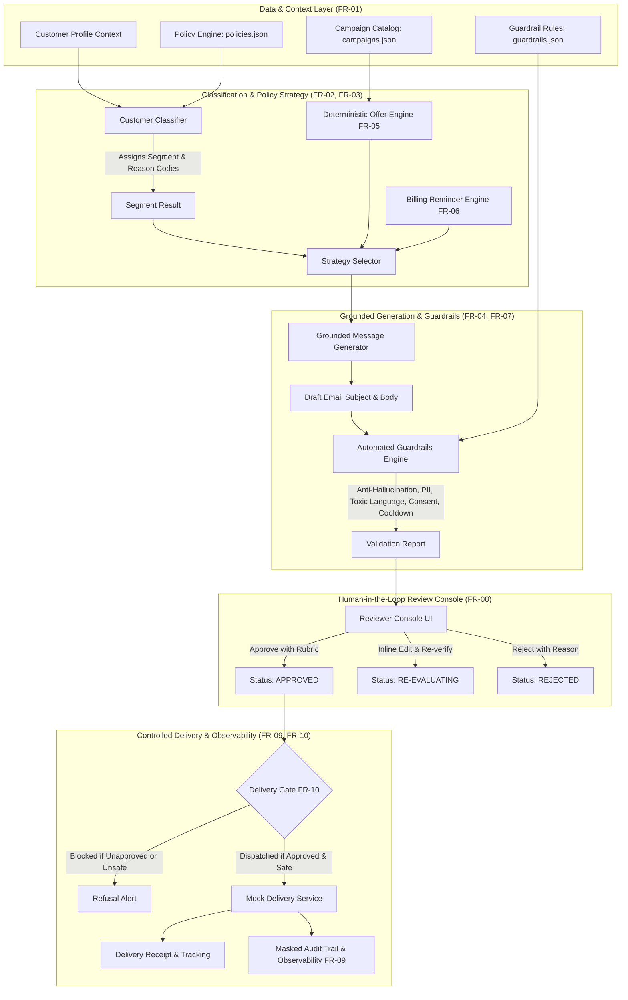

# Customer Loyalty and Engagement Assistant
**HCLTech | Future Ready AI Engineer Hackathon Submission**  
*Industry: Retail / Telecom Customer Engagement*

[]()
[]()
[]()
[-success.svg)]()
[]()

---

## 1. Project Overview & Problem Statement

Retail and telecom enterprises serve diverse customer bases spanning varied subscription plans, engagement patterns, loyalty tiers, and billing timeliness. Uniform communication approaches create significant brand and operational risk:
- Loyal VIP subscribers receive irrelevant generic promotions.
- Declining subscribers lapse into dormant churn without proactive intervention.
- Overdue subscribers receive inappropriate promotional gifts or overly aggressive debt notices violating compliance regulations.

The **Customer Loyalty and Engagement Assistant** is an enterprise-grade GenAI application that:
1. **Assembles Minimal Verified Context** from usage, tenure, tier, and billing indicators (FR-01).
2. **Performs Interpretable Customer Segmentation** with confidence scores and explicit feature reason codes (FR-02).
3. **Selects Policy-Approved Objectives and Tones** (FR-03).
4. **Generates Grounded Email Outreach** strictly tied to verified customer facts (FR-04).
5. **Enforces Deterministic Offer & Reward Controls** (FR-05).
6. **Executes Staged Billing Reminder Progressions** with mandatory dispute and hardship assistance paths (FR-06).
7. **Applies Multi-Layer Automated Guardrails** checking hallucination, PII, toxic tone, and consent (FR-07).
8. **Provides a Human-in-the-Loop Review Console** with an inline editor and quality scoring rubric (FR-08).
9. **Maintains Anonymized Audit Trails & Observability Metrics** (FR-09).
10. **Guarantees Controlled Delivery** via a mock email service with hard refusal gates (FR-10).

---

## 2. Architecture Diagram



---

## 3. Functional Requirements Traceability Matrix

| ID | Requirement Name | Implementation Component | Test Suite |
|---|---|---|---|
| **FR-01** | Customer Profile Assembly | [`backend/models/customer.py`](file:///D:/Data%20projects/customer-loyalty-engagement-assistant/backend/models/customer.py) | `tests/test_classification.py` |
| **FR-02** | Transparent Classification | [`backend/services/classifier.py`](file:///D:/Data%20projects/customer-loyalty-engagement-assistant/backend/services/classifier.py) | `tests/test_classification.py` |
| **FR-03** | Policy Strategy Selection | [`backend/services/strategy_selector.py`](file:///D:/Data%20projects/customer-loyalty-engagement-assistant/backend/services/strategy_selector.py) | `tests/test_api.py` |
| **FR-04** | Grounded Generation | [`backend/services/generator.py`](file:///D:/Data%20projects/customer-loyalty-engagement-assistant/backend/services/generator.py) | `tests/test_guardrails.py` |
| **FR-05** | Offer & Reward Controls | [`backend/services/offer_engine.py`](file:///D:/Data%20projects/customer-loyalty-engagement-assistant/backend/services/offer_engine.py) | `tests/test_offers.py` |
| **FR-06** | Billing Reminder Progression | [`backend/services/billing_engine.py`](file:///D:/Data%20projects/customer-loyalty-engagement-assistant/backend/services/billing_engine.py) | `tests/test_billing.py` |
| **FR-07** | Safety & Compliance Guardrails | [`backend/services/guardrails_engine.py`](file:///D:/Data%20projects/customer-loyalty-engagement-assistant/backend/services/guardrails_engine.py) | `tests/test_guardrails.py` |
| **FR-08** | Human Review & Feedback | [`backend/services/review_service.py`](file:///D:/Data%20projects/customer-loyalty-engagement-assistant/backend/services/review_service.py) | `tests/test_api.py` |
| **FR-09** | Audit & Observability | [`backend/services/audit_service.py`](file:///D:/Data%20projects/customer-loyalty-engagement-assistant/backend/services/audit_service.py) | `tests/test_api.py` |
| **FR-10** | Controlled Delivery Gate | [`backend/services/mock_delivery.py`](file:///D:/Data%20projects/customer-loyalty-engagement-assistant/backend/services/mock_delivery.py) | `tests/test_delivery.py` |

---

## 4. Preloaded Scenarios & Refusal Cases

The application includes 8 pre-configured scenarios representing the full operational spectrum:

1. **Consistent Customer (`Elena Vance`)**: 18-month tenure, steady usage (+2.5%), timely payments &rarr; Appreciation message with complimentary 20GB Loyalty Boost.
2. **Loyalty VIP Candidate (`Marcus Chen`)**: 36-month tenure, $110/mo spend, Platinum tier, CSAT 9.7 &rarr; Celebratory VIP recognition with 3-Month Premium Entertainment Pass.
3. **Declining-Activity Customer (`Sophia Rodriguez`)**: 38% usage drop over 90 days, active 8 days ago &rarr; Helpful check-in offering 50% Bonus Data plan refresh.
4. **Inactive / Dormant Customer (`David Miller`)**: 68 days inactive &rarr; Low-pressure win-back survey with $15 welcome-back credit.
5. **Overdue Bill - Stage 1 Courteous (`Amara Okafor`)**: $65.40 balance, 8 days overdue &rarr; Polite reminder, payment portal link, dispute support path. Promotional gifts prohibited.
6. **Overdue Bill - Stage 2 Firmer (`Liam O'Connor`)**: $185.00 balance, 24 days overdue &rarr; Direct notice of service interruption risks and hardship assistance hotline.
7. **REFUSAL CASE: Missing Marketing Consent (`Sarah Connor`)**: Customer has `email_opt_in: false` &rarr; System flags `CRITICAL` compliance violation, refuses draft generation, and blocks delivery.
8. **REFUSAL CASE: Ineligible / Contradictory Overdue Data (`Jordan Hayes`)**: Active $240 overdue balance attempted to receive a promotional reward &rarr; Offer engine deterministically rejects promotion; guardrails block conflicting outreach.

---

## 5. Quickstart & Installation

### Prerequisites
- Python 3.10+ (Tested on Python 3.14.6)
- Node.js (Optional for npm scripts)

### Installation
```bash
# Clone or navigate to the repository
cd "D:/Data projects/customer-loyalty-engagement-assistant"

# Install Python requirements
pip install -r requirements.txt
```

### Running Tests
Run the comprehensive 23-test validation suite:
```bash
pytest tests/ -v
```

### Launching the Web Application
```bash
python run_server.py
```
Open your browser to:
- **Application UI**: [http://127.0.0.1:8000](http://127.0.0.1:8000)
- **Interactive Swagger API Documentation**: [http://127.0.0.1:8000/docs](http://127.0.0.1:8000/docs)

---

## 6. API Reference

- `GET /api/scenarios`: Returns preloaded scenario profiles.
- `POST /api/classify`: Accepts a `CustomerProfile`, returns interpretable segment, confidence, and reason codes.
- `POST /api/strategy`: Returns mapped objective, tone, and reminder stage.
- `POST /api/generate`: Generates reviewable draft with grounded facts and guardrail report.
- `POST /api/guardrails/check`: Executes on-demand multi-factor safety check on arbitrary text.
- `GET /api/drafts`: Lists all drafts in review queue.
- `POST /api/drafts/{id}/approve`: Approves draft with human review rubric ratings (1–5).
- `POST /api/drafts/{id}/edit`: Inline edits draft subject/body and triggers immediate guardrail re-validation.
- `POST /api/drafts/{id}/reject`: Rejects draft with specified reason code.
- `POST /api/drafts/{id}/deliver`: Controlled mock delivery service (refuses if not approved or unsafe).
- `GET /api/audit`: Returns anonymized audit logs.
- `GET /api/observability`: Real-time system performance and compliance statistics.

---

## 7. License

MIT License. Developed for the HCLTech Future Ready AI Engineer Hackathon.
